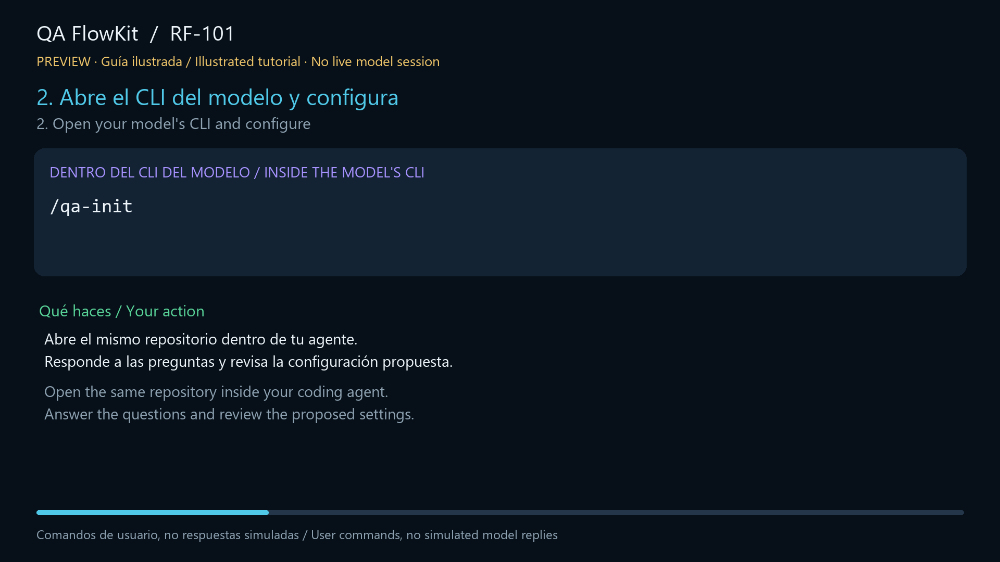

# RF-101 Agent-First Tutorial

The **user-approved bilingual illustrated tutorial** is included in this repository. It shows the intended journey:
**terminal installation only, then slash commands inside the model's CLI**.
It is not a captured model session and does not invent model replies or validation results. The approved cut retains
its on-screen preview/non-live label.

[](media/qa-flowkit-rf101-demo.mp4)

## Watch and choose audio

- [Bilingual MP4](media/qa-flowkit-rf101-demo.mp4): 115 seconds, 1920×1080, H.264/24 fps.
- Two selectable female audio tracks: **Castilian Spanish** (Piper Sharvard, default) and **English** (Kokoro).
- Two embedded subtitle tracks plus external [Spanish VTT](media/qa-flowkit-rf101-demo.es.vtt) and
  [English VTT](media/qa-flowkit-rf101-demo.en.vtt).
- Choose the audio language in your player's audio menu. Some browser players only expose the default track;
  download the MP4 and use a player with audio-track selection if needed.
- [GIF overview](media/qa-flowkit-rf101-demo.gif), [thumbnail](media/qa-flowkit-rf101-demo-thumbnail.png) and
  [voice attribution](media/ATTRIBUTION.md).

Machine-readable status and approved video hash: [demo.v1.json](demo.v1.json).

## User journey — inside the model

After installation, use `/qa-init` → `/qa-doctor` → `/qa-help` → `/qa-full-flow` → review → `/qa-status`.
Use `/qa-init --qa-context qa-ai-knowledge` as a context-aware starting alternative and `/qa-add-tests` for another
requirement. The model handles the internal scripts and phase checks; users do not drive them from another terminal.

Read the [English quick start](getting-started.md), [guía rápida](getting-started.es.md),
[script](demo-script.md), [bilingual storyboard](agent-first-storyboard.v1.json) or
[accessible transcript](demo-transcript.md).

## Developer fixture replay — separate from the tutorial

The public RF-101 fixture is a deterministic framework check, not a recording of the model or the video's user flow.
It covers intake, normalize, a deliberate missing-`@manual` Gherkin failure, correction, traceability and PR preparation.
From the QA FlowKit source repository:

```bash
npm run test:e2e-quick
```

Expected summary:

```text
[PASS] clean quick-track target initialized
[PASS] intentional missing @manual tag was rejected
[PASS] corrected Gherkin passed
[PASS] completed run and strict target validation
Quick path E2E passed in <duration>ms.
```

Source: [fixtures](../../test/fixtures/quick-path/) and
[runner](../../.github/scripts/run-quick-path-validation.mjs).
The replay uses no model execution or external writes. Artifact validation is not evidence that login tests executed.

Verification: `npm run test:product-demo`. Future media replacements follow the
[regeneration and approval instructions](media/regenerate-rf101-video-prompt.md).
